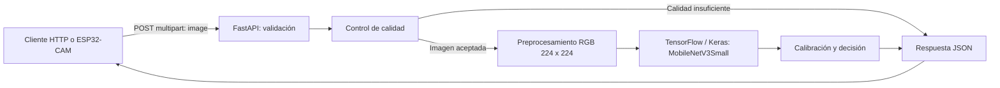
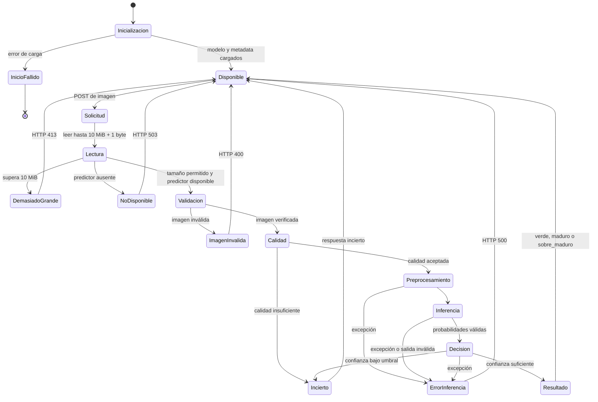

# Banana AI System V4 Remastered

Servicio de visión por computadora que recibe una fotografía de un plátano y clasifica su estado visual con un modelo TensorFlow/Keras. La API local se ejecuta con FastAPI dentro de Docker. El firmware de ESP32-CAM y el despliegue remoto no están incluidos en este repositorio.

Su objetivo es ofrecer una clasificación visual de madurez a clientes HTTP, incluida una respuesta compacta para ESP32-CAM. El alcance es la imagen completa: el sistema no identifica cada fruta por separado. La configuración principal utiliza Python 3.10, FastAPI, TensorFlow/Keras y Docker Compose.

## Contenido

- [Modelo de inteligencia artificial](#modelo-de-inteligencia-artificial)
- [Arquitectura](#arquitectura)
- [Dataset y evaluación](#dataset-y-evaluación)
- [Máquina de estados de la API](#máquina-de-estados-de-la-api)
- [Guía de compilación y ejecución](#guía-de-compilación-y-ejecución)
- [Pruebas](#pruebas)
- [Observabilidad y telemetría](#observabilidad-y-telemetría)
- [Publicación y actualización controlada de V4](#publicación-y-actualización-controlada-de-v4-pendiente-de-autorización)
- [Rollback a V2](#rollback-a-v2)
- [Evaluación y limitaciones conocidas](#evaluación-y-limitaciones-conocidas)
- [Versionado y release](#versionado-y-release)
- [Checklist de entrega](#checklist-de-entrega)

## Modelo de inteligencia artificial

La arquitectura definida en [`training/three_class/model.py`](training/three_class/model.py) emplea **MobileNetV3Small**, sin su cabeza original, seguido de `GlobalAveragePooling2D`, `Dropout(0.25)`, una capa densa de 128 unidades con ReLU y una salida softmax de tres clases. El entrenamiento V4 transfiere capas compatibles de V2 y reinicia la cabeza de clasificación. La entrada es RGB de **224 × 224 × 3**; las dependencias fijan TensorFlow y Keras 2.15.0.

[`inference/preprocessing.py`](inference/preprocessing.py) redimensiona mediante interpolación bilineal de TensorFlow y entrega `float32` en `[0,255]`; el preprocesamiento MobileNetV3 está incorporado. [`inference/predictor.py`](inference/predictor.py) aplica una temperatura de calibración de 0,5140569133 y un umbral de confianza de 0,5022543987, según [`models/metadata.json`](models/metadata.json). Ambos son experimentales; el umbral se seleccionó en desarrollo y no se calibró independientemente. Antes de inferir, [`inference/image_quality.py`](inference/image_quality.py) puede provocar abstención por oscuridad, sobreexposición o posible desenfoque. Estas heurísticas no garantizan detectar todas las imágenes inadecuadas.

## Clases y límites del modelo

El modelo activo `banana_ai_v4_remastered` (versión `4.0.0`) produce exactamente estas tres clases, en este orden:

1. `verde`: inmaduro.
2. `maduro`: maduración normal.
3. `sobre_maduro`: maduración avanzada.

La API usa `incierto` como abstención operativa, no como cuarta clase. `/predict` informa `estado`, `confianza` e `incierto`; si se abstiene, `estado` es `incierto`. `/predict/esp32` devuelve exclusivamente `estado`. El modelo clasifica la imagen completa; no detecta ni separa cada fruta, y no hay evidencia validada para resumir manos con estados mezclados.

El checkpoint está en `models/production_model_v4.keras`; su SHA-256 verificado es `2cb2918270422b0569e32a0198d16b16d212c5ffeb08e95f465ffc4fc646a9e6`. La metadata emparejada es `models/metadata.json`. El preprocesamiento V4 recibe RGB de 224×224 en rango `[0,255]`; la normalización de MobileNetV3 está incorporada en el propio modelo. No agregues una segunda normalización ni cambies el orden de clases sin actualizar y validar juntos modelo, metadata e inferencia.

## Arquitectura



FastAPI utiliza [`api/main.py`](api/main.py), [`api/routes.py`](api/routes.py) y [`api/schemas.py`](api/schemas.py); el predictor carga [`models/production_model_v4.keras`](models/production_model_v4.keras) con su [metadata](models/metadata.json). El firmware ESP32-CAM no se incluye y su funcionamiento en dispositivo no está verificado aquí.

## Dataset y evaluación

Recuento histórico observado en el directorio de trabajo. Estas carpetas y los artefactos experimentales pueden estar ignorados y no necesariamente acompañan una copia de Git. Los conteos son archivos por carpeta, no pruebas de imágenes únicas o independientes.

| Dataset y división | Verde / unripe | Maduro / ripe | Sobre maduro / overripe | Podrido / rotten | Total |
|---|---:|---:|---:|---:|---:|
| `dataset/train` | 250 | 250 | 250 | 250 | 1.000 |
| `dataset/test` | 50 | 50 | 50 | 50 | 200 |
| `data/dataset_v2/train` | 2.128 | 3.772 | 2.598 | 4.270 | 12.768 |
| `data/dataset_v2/validation` | 167 | 339 | 229 | 388 | 1.123 |
| `data/dataset_v2/test` | 160 | 204 | 163 | 235 | 762 |

V4 excluye `podrido`. Su ejecución histórica utilizó 8.498 imágenes de entrenamiento de las tres clases y una reserva derivada de la validación histórica. El filtrado por similitud dHash es aproximado y no prueba independencia de fruta o sesión. El informe local `artifacts/v4_remastered/v4_transfer_v2_seed4072026_20261022_run04/evaluation_final.json`, no versionado en Git, registra las siguientes métricas para 101 representantes:

| Métrica histórica V4 | Resultado |
|---|---:|
| Accuracy | 99,01 % (100/101) |
| Macro-F1 | 0,9912 |

Matriz de confusión: filas reales y columnas predichas, en el orden `verde`, `maduro`, `sobre_maduro`.

| Real / predicha | verde | maduro | sobre_maduro |
|---|---:|---:|---:|
| verde | 22 | 0 | 0 |
| maduro | 0 | 47 | 1 |
| sobre_maduro | 0 | 0 | 31 |

**Esta reserva procede de una partición histórica utilizada durante el desarrollo; no es una evaluación independiente de producción.** Son métricas experimentales, no telemetría operativa. Hay imágenes de ejemplo versionadas en [`test_images/`](test_images/), por ejemplo [`banana.jpeg`](test_images/banana.jpeg); no se atribuye una etiqueta validada a ese ejemplo.

## Máquina de estados de la API

El siguiente diagrama es una FSM **conceptual** derivada del flujo de [`api/main.py`](api/main.py), [`api/routes.py`](api/routes.py) y [`inference/predictor.py`](inference/predictor.py). No es una FSM explícitamente implementada ni describe el firmware. La inicialización ocurre al arrancar; cada solicitud de predicción recorre después su propio flujo.



## Guía de compilación y ejecución

El contenedor oficial se define en `Dockerfile` y `docker-compose.yml`; Compose construye `banana-ai:v4-production` para `linux/amd64`. Por defecto solo publica en `127.0.0.1:8000`, reinicia el servicio salvo parada explicita y aplica limites configurables de 1 CPU y 1 GiB, con rotacion de logs `json-file` de 10 MiB x 3 archivos. `.env.example` muestra las variables para ajustar bind address, puerto, CPU, memoria y logs a la instancia real; mide bajo carga antes de elegir valores EC2. `/health` informa el modelo y version. `/predict` y `/predict/esp32` aceptan JPEG, PNG o WebP multipart en `image` hasta 10 MiB. `/predict` devuelve exactamente `estado`, `confianza`, `incierto`; ESP32 devuelve solo `estado` o `incierto`. El firmware que usaba `/predict` debe cambiar a `/predict/esp32`. La API no incluye TLS ni autenticacion: para acceso remoto usa un proxy seguro o reglas de red limitadas a origenes autorizados; no publiques el puerto directamente en Internet.

## Requisitos

- Docker Desktop o Docker Engine con el daemon iniciado y Docker Compose v2.
- Para pruebas locales: Python 3.10 y los paquetes de `requirements.txt` y `requirements-dev.txt`.
- Copia `.env.example` a `.env` para ajustar `API_BIND_ADDRESS`, `API_PORT`, `BANANA_CPUS`, `BANANA_MEM_LIMIT`, `DOCKER_LOG_MAX_SIZE` y `DOCKER_LOG_MAX_FILES`; los defaults son una base inicial, no una dimension EC2 validada.
- La imagen se construye como `linux/amd64`. Comprueba la compatibilidad de arquitectura del servidor destino antes de desplegar.
- El checkpoint V4 versionado en el repositorio (aprox. 5 MiB) y la metadata incluida.

Comprobación de Docker en PowerShell:

```powershell
docker info
docker compose version
```

## Compilar, iniciar y comprobar Docker

Desde la raíz del repositorio, construye la imagen y después inicia el servicio:

```powershell
docker compose build
docker compose up -d
```

También se conserva el comando original que construye y arranca en un solo paso, seguido de la verificación:

```powershell
docker compose up --build -d
docker compose ps
Invoke-RestMethod http://localhost:8000/health
```

La respuesta de salud esperada incluye `status: ok`, `model: banana_ai_v4_remastered` y `version: 4.0.0`. El estado del servicio en `docker compose ps` debe ser `healthy`.

## Predecir una imagen desde terminal

Con la API levantada, usa el script `scripts/predict_image.py`; envía la imagen a Docker local y no carga un segundo modelo en la máquina:

```powershell
python scripts/predict_image.py test_images/banana.jpeg
```

El script muestra el estado, la confianza y, si aplica, si el sistema se abstuvo. Acepta una ruta a otra imagen compatible y la opción `--url` para una API accesible en otro host:

```powershell
python scripts/predict_image.py test_images/banana2.jpeg --url http://localhost:8000
```

También puedes llamar directamente a la API:

```powershell
curl.exe -X POST http://localhost:8000/predict -F "image=@test_images/banana.jpeg"
curl.exe -X POST http://localhost:8000/predict/esp32 -F "image=@test_images/banana.jpeg"
```

Las rutas de predicción reciben `multipart/form-data` con el campo obligatorio `image`. `/predict` responde, por ejemplo, `{"estado":"maduro","confianza":0.95,"incierto":false}`; los valores son ilustrativos. `/predict/esp32` devuelve únicamente `{"estado":"maduro"}`. Los formatos JPEG, PNG y WebP están documentados; el código declara esos tipos, pero no aplica una comprobación explícita del MIME y utiliza Pillow para verificar los datos.

| Código | Situación |
|---|---|
| 400 | Imagen que no se puede identificar o verificar. |
| 413 | La imagen supera 10 MiB. |
| 422 | Falta el campo obligatorio o falla la validación de la solicitud. |
| 503 | El predictor no está disponible. |
| 500 | Excepción durante el preprocesamiento o la predicción. |

Una ruta local inexistente produce un error en el cliente antes de enviar la imagen. El inicio también puede fallar si faltan o no coinciden el modelo y su metadata.

## Pruebas

Con el entorno Python del proyecto y sus dependencias instaladas:

```powershell
python -m pytest -q
```

La suite cubre contratos, preprocesamiento, metadatos, calidad, inferencia, API y entrenamiento. Las pruebas automatizadas no sustituyen la evaluación estadística en fotografías reales independientes.

En [`tests/`](tests/) se encuentran pruebas del contrato HTTP y de metadatos, transferencia V4 y hash del checkpoint, preparación de tres clases, calidad de imagen, aumentos y evaluación V3, y validación de observaciones temporales. El registro histórico de este README indica **39 pruebas aprobadas el 22/10/2026**; otro registro local de ese día (`artifacts/production_release/v4_local_production_20261022.json`, no versionado) informa 37 aprobadas en una ejecución anterior. No representan una ejecución actual ni prueban que el servicio esté activo.

## Observabilidad y telemetría

| Categoría | Evidencia disponible | Alcance |
|---|---|---|
| Métricas experimentales | Accuracy, macro-F1 y matriz de la sección de evaluación. | Resultados históricos de modelo; no son mediciones operativas. |
| Logs y salud | [`api/main.py`](api/main.py) y [`api/routes.py`](api/routes.py) registran carga, errores y advertencias; [`docker-compose.yml`](docker-compose.yml) configura rotación y healthcheck. | La configuración no demuestra que el servicio esté activo. |
| Dashboard operativo | No se identificó un dashboard activo ni un enlace verificable. | Pendiente de evidencia y URL reales. |

### Dashboard de telemetría: pendiente de enlace verificable

**URL del dashboard: pendiente de proporcionar y verificar.** Los logs y el healthcheck no sustituyen un dashboard de telemetría. No se presenta un enlace de ejemplo como si fuera un servicio activo.

## Detener, reiniciar y consultar logs

```powershell
docker compose logs --tail 100 banana-api
docker compose restart banana-api
docker compose down
```

`docker compose down` detiene y elimina el contenedor de este proyecto; no borra volúmenes ni imágenes. No uses comandos globales de prune para limpiar Docker.

## Publicación y actualización controlada de V4 (pendiente de autorización)

La imagen local `banana-ai:v4-production` es `linux/amd64` e incluye `models/production_model_v4.keras` y `models/metadata.json`. La imagen contiene el checkpoint, por lo que publicar la imagen también distribuye esos artefactos. No se ha publicado en Docker Hub ni desplegado en AWS. Usa un tag que identifique esta versión y el commit; para una referencia inmutable, despliega por digest y configura la política de tags inmutables del repositorio Docker Hub si está disponible.

Publicación manual después de autorizarla:

```powershell
$Image = "<DOCKERHUB_USER>/<DOCKERHUB_REPOSITORY>"
$Tag = "v4.0.0-b5d51f1"
docker login
docker tag banana-ai:v4-production "${Image}:${Tag}"
docker push "${Image}:${Tag}"
docker buildx imagetools inspect "${Image}:${Tag}"
```

Registra el `Digest: sha256:...` que imprime `imagetools inspect`. Verifica que la arquitectura publicada incluya `linux/amd64`. La etiqueta versionada facilita la lectura; el digest es la referencia que debe fijar EC2.

Antes de actualizar EC2, conserva la imagen actual con otro tag local. En una instancia preparada con Docker/Compose, credenciales de solo lectura para el repositorio privado (si aplica), archivos de Compose y acceso restringido por firewall/security group:

```bash
export IMAGE="<DOCKERHUB_USER>/<DOCKERHUB_REPOSITORY>"
export TAG="v4.0.0-b5d51f1"
export PREVIOUS_TAG="<TAG_ANTERIOR>"
export DIGEST="sha256:<DIGEST_VERIFICADO>"
docker image tag banana-ai:v4-production banana-ai:v4-production-rollback-${PREVIOUS_TAG}
docker pull "${IMAGE}@${DIGEST}"
docker image tag "${IMAGE}@${DIGEST}" banana-ai:v4-production
docker compose up -d --no-build
docker compose ps
curl --fail http://127.0.0.1:8000/health
curl --fail -X POST http://127.0.0.1:8000/predict/esp32 -F "image=@<RUTA_LOCAL>/banana.jpg"
```

Confirma `healthy`, V4 `4.0.0` y que la respuesta ESP32 contenga solo `estado` con un valor entre `verde`, `maduro`, `sobre_maduro` o `incierto`. `/predict/esp32` conserva multipart/form-data y el campo `image`. Un firmware que antes usaba `/predict` debe cambiar la ruta a `/predict/esp32`; debe tratar `incierto` como abstención. No se encontró firmware en este repositorio, así que su compatibilidad en dispositivo no está verificada.

Rollback de V4 sin borrar la imagen anterior:

```bash
docker image tag banana-ai:v4-production-rollback-${PREVIOUS_TAG} banana-ai:v4-production
docker compose up -d --no-build
docker compose ps
curl --fail http://127.0.0.1:8000/health
```

Compara la versión/modelo con el release previo y confirma `healthy` antes de cerrar la operación. Las reglas de entrada de AWS deben limitar el puerto publicado a los clientes autorizados o a un proxy con TLS/autenticación; la API no implementa TLS ni autenticación por sí misma. No actualices en producción sin una validación independiente representativa de cámara, luz y plátanos.

## Rollback a V2

V2 es un respaldo legacy de cuatro clases que se ejecuta en un contenedor separado; no forma parte del servicio configurado V4. Un registro histórico indica que se verificó localmente la imagen `banana-ai:v2-rollback` (ID `sha256:61559badadebf623337eed07ad42f45a5677b22217e486fcbec6f10941806a30`, `linux/amd64`) junto con su checkpoint y metadata V2 conservados localmente en `models/production_model.h5` y `docker/api_metadata_v2_h5.json`. La imagen ya construida es el método de rollback descrito después de retirar los Dockerfiles y Compose alternativos; su disponibilidad actual debe comprobarse antes de usarla.

La imagen V2 se documentó como existente únicamente en el daemon Docker local de la verificación histórica; no está en Git y su disponibilidad actual o publicación posterior no se han verificado. Antes de limpiar o cambiar de equipo, confirma su disponibilidad y, si procede, expórtala o publícala en un registro privado autorizado y verifica que se pueda recuperar.

Para cambiar temporalmente el puerto 8000 a V2:

```powershell
docker compose down
docker run -d --name banana-api-v2-rollback --restart unless-stopped -p 8000:8000 banana-ai:v2-rollback
Invoke-RestMethod http://localhost:8000/health
```

Comprueba que salud indique la versión `2.0.0`. Para volver a V4, detén V2 y arranca el servicio oficial:

```powershell
docker stop banana-api-v2-rollback
docker rm banana-api-v2-rollback
docker compose up -d
Invoke-RestMethod http://localhost:8000/health
```

Para probar que la imagen V2 local aún arranca y responde sin tocar producción, puedes ejecutar `python scripts/verify_v2_rollback.py`; usa temporalmente el puerto 8001 y retira su contenedor al terminar.

No ejecutes ambos servicios a la vez en el puerto 8000. No mezcles el checkpoint V2 con metadata V4. La imagen de rollback se probó localmente y responde con el contrato legacy; la API V2 puede devolver `podrido`.

## Evaluación y limitaciones conocidas

### Verificación local del release

Verificacion de este cambio (22/10/2026): `python -m pytest -q` termino con **39 pruebas aprobadas** y advertencias deprecadas. El benchmark exploratorio `python scripts/benchmark_lighting.py` evaluo 9 imagenes locales y 11 variantes por imagen: **87,88 %** mantuvo exactamente el estado; hubo **12 cambios de estado**: **2 cambios entre clases de madurez** y **10 transiciones hacia/desde incierto**. Hubo 11 respuestas inciertas entre variantes, incluida una variante de una imagen que ya era incierta. La diferencia absoluta media de confianza fue **0,1192**. No hay etiquetas reales y estas imagenes no constituyen un test independiente; estos resultados miden sensibilidad, no accuracy. Los cambios bajo brillo/sombra indican que V4 aun no es invariante a iluminacion. `/health`, `/predict`, `/predict/esp32`, OpenAPI y healthcheck Docker se verificaron; las cargas invalidas devolvieron HTTP 400.

El 99,01% de accuracy (100/101) y macro F1 0,9912 se reportaron en una reserva agrupada derivada de una partición histórica de validación. **No es una evaluación independiente nueva** y esa partición influyó en el desarrollo. Las perturbaciones de iluminación existentes son sintéticas; faltan pruebas representativas con cámaras reales, ESP32-CAM, grupos/manos de fruta y condiciones reales de luz. No se debe interpretar la promoción local como evidencia de precisión o invariancia lumínica en producción.

El sistema clasifica la imagen global y no localiza plátanos, no distingue cada fruta parcialmente superpuesta y no ha sido validado con madurez mixta. La abstención usa heurísticas experimentales de calidad/confianza y no detecta necesariamente toda imagen fuera de distribución. La puerta de exposición usa luminancia global y cuantiles de los píxeles no recortados; tolera un fondo blanco cuando el resto de la imagen no está también sobreexpuesto, pero no localiza el plátano y puede fallar en escenas de color extremo. No se aplica corrección de color, por lo que la iluminación todavía puede cambiar la predicción.

V4 fue integrado como principal de producción **local** por solicitud explícita; no se ha desplegado en AWS ni se ha publicado en Docker Hub. El dataset, resultados experimentales, checkpoints históricos y configuraciones de entrenamiento permanecen en el repositorio de trabajo o en artefactos ignorados cuando aplica; el contexto operativo de producción queda documentado aquí.

## Versionado y release

En la inspección local de Git se observó el tag histórico `v1.0-production`, cuya descripción se refiere al despliegue de **V2** en AWS EC2. No se observó un tag con el nombre exacto `v1.0`, y el tag histórico no debe interpretarse como release de V4. Para el release académico V4 queda pendiente confirmar la revisión que se entregará y crear posteriormente el tag exacto `v1.0` si el profesor lo exige. No se ha creado aquí.

## Checklist de entrega

| Requisito del profesor | Estado verificable | Evidencia | Pendiente |
|---|---|---|---|
| Repositorio digital cerrado | No verificado | La privacidad y los permisos no pueden deducirse de Git local. | Confirmar y documentar acceso restringido en el proveedor. |
| Tag `v1.0` | Pendiente de confirmación | Existe `v1.0-production` histórico de V2; no se observó `v1.0` exacto. | Confirmar revisión V4 y criterio del profesor; crear el tag exacto si corresponde. |
| Guía de compilación | Documentada; ejecución actual no verificada | Secciones de requisitos y compilación; `Dockerfile` y `docker-compose.yml`. | Verificar la guía en un entorno autorizado antes de la entrega. |
| Diagrama FSM | Documentado | Diagrama conceptual de solicitud basado en el código de API e inferencia. | Confirmar que su alcance satisface la rúbrica. |
| Enlace activo al dashboard de telemetría | No verificado | No se identificó URL ni dashboard operativo verificable. | Proporcionar y comprobar una URL real. |
